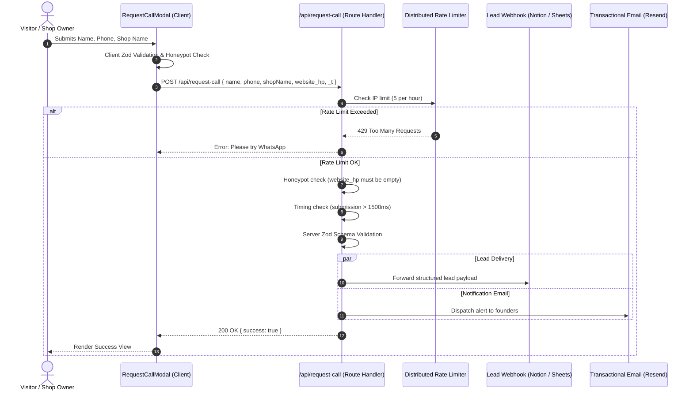

# MeetCtrlP Main Website: Product Requirements Document (PRD)

**Route:** `meetctrlp.in/`  
**Version:** 1.1 (Comprehensive Engineering & Architecture Specification)  
**Status:** Build-ready  
**Audience for this document:** AI agents, software engineers, design system leads, and product owners building and maintaining the site end to end.  
**Read order:** Sections 1 to 3 give context, user personas, and IA. Section 4 is the visual design system and tokens. Section 5 specifies every page section in order. Sections 6 to 8 cover content governance, quality, and analytics. Section 9 is the mandatory Engineering Architecture (stack, monorepo, API, security, testing). Section 10 covers QA and launch.

---

## 0. Document Control, Glossary & Governance

### 0.1 Revision History

| Version | Date | Author | Summary of Changes |
|---|---|---|---|
| 1.0 | 2026-10-17 | Product Team | Initial build-ready PRD covering UI sections, tokens, and general rules. |
| 1.1 | 2026-10-17 | Engineering & Product Architecture | Deep engineering overhaul: added distributed serverless rate limiting, Zod API schemas, Tailwind v4 theme architecture, CSP edge middleware, complete component server/client matrix, monorepo workspace integration, audit tooling specs, and testing matrices. |

### 0.2 Core Glossary & Concept Definitions

| Term | Definition in this Project |
|---|---|
| **MeetCtrlP** | The overarching brand entity (unregistered brand; do not append legal suffixes like Pvt Ltd). |
| **CtrlP** | The product: a QR-driven document submission and print job management workflow. |
| **Print User** | End customer needing prints. Operates strictly as a guest via shop-specific QR code at `app.meetctrlp.in/`. No accounts or passwords. |
| **Print Shop Partner** | Local print shop business operator using desktop software (Tauri + C# agent) to receive structured orders and print. |
| **Concept Tag (`<ConceptTag />`)** | Mandatory visual badge attached to all preview screens indicating illustrative prototype UI, never real captures. |
| **Claims Registry** | Central typed configuration (`claims.ts`) governing factual statements. Claims only render when verified by product delivery. |
| **Single Source of Truth (SSOT)** | Zero hardcoding policy: every color, token, string, URL, and route is bound to a typed config module. |

### 0.3 Monorepo Governance & Design System Alignment

This application lives in a monorepo alongside the Print Shop Desktop application (`apps/print-shop`), Print Agent (`apps/print-agent`), and shared packages (`packages/ui`, `packages/config`, `packages/schemas`).

- **Design System Relationship:** The repository UI rule in `AGENTS.md` defines the operational utility design system (`docs/design-system/` and `@ctrlp/ui`) used by the desktop and admin tools (flat, 12px radius, dark green action, high density). In contrast, `apps/company-site` is the **public-facing editorial brand website**. It uses the curated editorial brand theme defined in Section 4 (`tokens.css` + Tailwind v4 `@theme`, soft off-white `#F8F9F8`, lime `#B8E04A`, Instrument Serif typography, painterly landscape art).
- **Package Consumption:** `company-site` must reuse shared non-UI packages (`@ctrlp/config`, `@ctrlp/schemas`) and utility functions (`cn`, formatting helpers) from `@ctrlp/ui/utils` where applicable, without coupling its editorial typography and tokens to desktop app components.
- **Turborepo Integration:** Must declare pipeline inputs/outputs in the root `turbo.json` under the `company-site#build` task.

### 0.4 Core Execution Rules

1. **Build strictly the sections in Section 5**, in that exact sequence. Do not invent additional sections.
2. **Use tokens in Section 4 and Section 9.4** as the single source of truth for colour, type, spacing, and motion.
3. **All copy in Section 5 is final** unless marked `{{PLACEHOLDER}}`. Do not introduce unauthorized marketing claims.
4. **Every product visual is a concept** and must carry the Concept tag (Section 4.9).
5. **Claims marked [VERIFY]** must be controlled through the claims registry (Section 6.2). They render only when `verified: true`.
6. **Zero hardcoded values**: Strings, colors, URLs, and dimensions must live in typed config/token files as required by Section 9.3.

---

## 1. Product Context

**Company:** MeetCtrlP  
**Product:** CtrlP, a QR-based printing workflow that connects people who need prints with local print shops.

### How CtrlP Operates
- **Print User (guest, no account):** Scans a shop-specific QR code, uploads documents (PDF, DOCX, PPTX, JPG, PNG), configures print settings (color/B&W, copies, paper size, page selection), previews price, pays online or at shop, tracks status, and collects prints.
- **Print Shop Partner:** Uses desktop software to receive structured orders, review files, send jobs directly to connected printers via local print agent, update order statuses, and collect cash payments.
- **Platform:** Central order broker, payments router, and shop management engine.

> **Crucial Routing Guardrail:** The Print User app lives at `app.meetctrlp.in/` and is **only accessible through a shop-specific QR code**. The main company website (`meetctrlp.in/`) must **never** offer direct document upload, start an order, or link into the app without a shop context.

---

## 2. Purpose, Goals, Personas & Guardrails

### 2.1 The Single Job for This Site

> Help a visitor understand CtrlP in about 30 seconds, establish immediate engineering and operational credibility, and navigate them to the appropriate persona destination (Print User info or Print Shop onboarding).

### 2.2 Primary Goals

1. **Clarity:** A visitor can clearly articulate what CtrlP does after viewing the hero and scrolling once.
2. **Credibility:** The site feels human, crafted, and transparent. No fake social proof, no unbuilt features masquerading as live.
3. **Routing:** Visitors transition seamlessly to either `/print` (for users) or `/print-shops` (for shop owners) in one click.
4. **Shop Lead Capture:** Print shop owners can initiate contact via WhatsApp or request a call through an accessible modal form.

### 2.3 Non-Goals (Strictly Forbidden on This Site)

- Pricing tables or tier plans (shop pricing belongs exclusively on `/print-shops`).
- Generic FAQs (belongs on persona pages).
- Bento grid feature dumps (reserved for `/print-shops`).
- Printer compatibility driver lists or security whitepapers.
- Testimonials, customer logos, award badges, fake review counts, or "trusted by 500+ shops" banners. None exist yet and none may be fabricated.
- Direct document upload or file processing on this domain.

### 2.4 User Personas

| Persona | Description & Mindset | Primary Action on Site |
|---|---|---|
| **Ad-Hoc Print User** | College student, professional, or legal applicant who encountered a print shop QR or heard about CtrlP. Frustrated by WhatsApp print queues and privacy leaks. | Reads Hero & How It Works; clicks "See how printing works" (`/print`). |
| **Print Shop Owner** | Independent retail operator managing 50–500 walk-ins daily. Overwhelmed by WhatsApp downloads, printer driver mismatches, and counter friction. | Scans Problem/Solution; clicks "Discover CtrlP for Print Shops" or initiates WhatsApp chat / Call Request. |
| **Evaluator / Partner** | Tech evaluator, potential collaborator, or investor checking team execution speed and product polish. | Reviews narrative tone, Founder note, and technical craftsmanship. |

### 2.5 Differentiation Matrix

| Printing Today (Status Quo) | CtrlP Solution |
|---|---|
| Customer emails or sends file on personal WhatsApp; phone numbers exposed. | Zero-account QR scan; files routed directly into structured shop queue. |
| Shop owner manually downloads file, opens Acrobat, selects pages, inspects color. | Structured metadata: color mode, copies, exact page ranges pre-calculated. |
| Price disputes at counter ("You printed color instead of B&W"). | Instant price calculation shown to user before submission. |
| Manual WhatsApp typing: "Is it ready?" / "5 mins". | Real-time live status tracker on user's browser. |

### 2.6 Privacy & Zero-Data Liability Boundaries

The company landing site does not store, transmit, or process user documents. 
- The lead capture form (`/api/request-call`) collects solely Name, Phone, and optional Shop Name for inbound partner sales.
- Phone numbers are never logged to analytics, never written to public logs, and are masked in backend error monitors.
- Analytical tracking is cookieless and GDPR/ePrivacy compliant by design.

### 2.7 Success Metrics

| Type | Metric Target | Instrumentation |
|---|---|---|
| **Primary Conversion** | ≥ 4.5% conversion rate on (WhatsApp Clicks + Call Submissions) / Unique Visitors | `whatsapp_click`, `request_call_submit` |
| **Routing Efficiency** | ≥ 30% click-through rate to `/print-shops` or `/print` | `cta_print_shops_click`, `door_user_click` |
| **Engagement** | ≥ 60% scroll reach to `#how-it-works` | `section_view` (`id="how-it-works"`) |
| **Performance** | Mobile Lighthouse ≥ 95; LCP < 2.0s; CLS < 0.05; INP < 150ms | Automated CI LHCI run |

---

## 3. Information Architecture & Navigation

### 3.1 Route Map

| Route | Status | Description & Engineering Behavior |
|---|---|---|
| `/` | **Build Now** | Main landing page (this document). Statically generated. |
| `/print` | Stub | Print User page. Until PRD 2 is built, render an on-brand stub explaining the QR flow with WhatsApp link. |
| `/print-shops` | Stub | Print Shop partner page. Until PRD 3 is built, render an on-brand stub with lead form and WhatsApp CTA. |
| `/journey` | Flagged | Product changelog and founder updates. Controlled by `NEXT_PUBLIC_SHOW_JOURNEY` (default `false`). Hidden from nav and sitemap when false. |
| `/privacy` | **Required** | Plain-language privacy policy covering lead capture and cookies. |
| `/terms` | **Required** | Standard website terms of service. |
| `/api/request-call` | **Build Now** | Edge/Serverless Route Handler processing partner lead submissions. |
| `/api/health` | **Build Now** | Healthcheck endpoint returning `{ status: "ok", timestamp: ... }`. |

### 3.2 Sticky Header Architecture

- **Left:** SVG or typography wordmark `MeetCtrlP` (links to `/`).
- **Centre (Desktop):** Links to `#how-it-works` (smooth scroll), `/print-shops`, and `/journey` (conditional on flag).
- **Right:** Primary button `Explore CtrlP` (smooth scroll to `#how-it-works`).
- **Header State Machine:**
  - `Scroll Y < 24px`: Completely transparent background, border transparent.
  - `Scroll Y >= 24px`: Transitions over 200ms to `--color-bg` with 85% opacity, `backdrop-filter: blur(12px)`, and bottom 1px border `--color-line`.
- **Z-Index Layer:** `--z-sticky` (50).
- **Mobile Menu Sheet:**
  - Hamburger toggle right-aligned.
  - Opens full-screen overlay sheet with focus trapped (`aria-modal="true"`, `role="dialog"`).
  - Background: `--color-bg` at 98% opacity.
  - Dismisses on `Escape` key, backdrop touch, or link click.
  - Body scroll locked when sheet is active (`overflow: hidden`).
- **Skip Link:** Hidden `<a href="#main-content" className="sr-only focus:not-sr-only ...">Skip to content</a>` as the first interactive element.

### 3.3 Z-Index Layering Scale

```css
:root {
  --z-background: 0;
  --z-content:    10;
  --z-sticky:     50;
  --z-popover:    100;
  --z-modal:      200;
  --z-toast:      300;
}
```

### 3.4 CTA Hierarchy Matrix

| Level | Component Label | Target Action | Visual Style |
|---|---|---|---|
| **Primary** | Explore CtrlP | Scroll to `#how-it-works` | Lime fill `--color-lime`, ink text, 10px radius |
| **Secondary** | For Print Shops | Navigate to `/print-shops` | Transparent, 1px ink border, hover ink fill |
| **Contextual** | See how printing works | Navigate to `/print` | Outline or secondary pill with arrow glyph "→" |
| **Contextual** | Discover CtrlP for Print Shops | Navigate to `/print-shops` | Lime fill or high-contrast button on dark cards |
| **Conversion** | Talk to us on WhatsApp | Open `wa.me` with prefilled message | Lime fill or WhatsApp badge style |
| **Conversion** | Request a call | Open `<RequestCallModal />` | Secondary or primary button trigger |
| **Text Link** | Contact us → | Open mailto / scroll to `#contact` | Inline text link with 4px hover nudge on arrow |

---

## 4. Design System & Design Tokens

### 4.1 Design Principles

1. **Editorial, Minimal, Confident:** Generous whitespace, disciplined typography hierarchy, single lime accent.
2. **Honesty Over Hyperbole:** Concepts are strictly labelled; unverified claims do not render.
3. **Warm Humanity:** Soft off-white canvas, painterly landscape art, expressive serif display font.
4. **Functional Flatness:** Clean lines, subtle border separation, zero bloated shadow effects or decorative clutter.

### 4.2 Colour Tokens & CSS Variables

Tokens are declared in `src/styles/tokens.css` and bound to Tailwind v4 via `@theme`:

```css
:root {
  /* Surfaces */
  --color-bg:             #F8F9F8; /* Soft paper canvas */
  --color-surface:        #FFFFFF; /* Cards, concept frames */
  --color-surface-sunken: #EEF2EC; /* Alternate section bands */
  --color-forest:         #0F1A12; /* Deep dark panels */

  /* Text & Ink */
  --color-ink:            #111611; /* Primary headings and body */
  --color-ink-soft:       #4A554A; /* Secondary descriptions */
  --color-ink-faint:      #667166; /* Captions, chips, labels */
  --color-ink-on-forest:  #E9EFE6; /* High contrast text on dark backgrounds */

  /* Hairlines & Borders */
  --color-line:           #DCE2DB; /* Light borders */
  --color-line-on-forest: #2A3A2E; /* Dark card borders */

  /* Brand Accents */
  --color-lime:           #B8E04A; /* Primary button, status dots */
  --color-lime-soft:      #E7F4BE; /* Background tints, hover states */
  --color-lime-deep:      #3F7A12; /* High-contrast text accent (≥4.5:1 WCAG AA) */

  /* Concept Status Chips */
  --chip-paid-bg:    #DFF3E4;  --chip-paid-fg:    #1D5E34;
  --chip-pending-bg: #FBEBCB;  --chip-pending-fg: #7A4A05;
  --chip-error-bg:   #FADADA;  --chip-error-fg:   #8A1F1F;
  --chip-info-bg:    #E3ECF8;  --chip-info-fg:    #1F4A7A;

  /* Elevation & Shadows */
  --shadow-card:  0 1px 2px rgba(17, 22, 17, 0.06), 0 12px 32px -12px rgba(17, 22, 17, 0.16);
  --shadow-modal: 0 8px 32px rgba(17, 22, 17, 0.24);

  /* Radius Scale */
  --radius-sm:   10px;
  --radius-md:   16px;
  --radius-lg:   24px;
  --radius-xl:   32px;
  --radius-pill: 9999px;

  /* Durations & Easings */
  --duration-fast:     160ms;
  --duration-standard: 320ms;
  --duration-scene:    600ms;
  --ease-standard:     cubic-bezier(0.2, 0.8, 0.2, 1);
}
```

### 4.3 Typography Tokens

- **Display Font:** `Instrument Serif` (loaded via `next/font/google` with weights `400` normal and italic).
- **Body Font:** `Inter` (loaded via `next/font/google` with weights `400`, `500`, `600`).

| Role | Font | Size Token (Fluid Clamp) | Line Height | Letter Spacing | Weight |
|---|---|---|---|---|---|
| **Display XL** (Hero H1) | Display | `clamp(3.25rem, 9vw, 8rem)` | 0.95 | -0.035em | 400 |
| **Display L** (Section H2) | Display | `clamp(2.25rem, 5vw, 4rem)` | 1.02 | -0.025em | 400 |
| **Display M** (Doors / Closing) | Display | `clamp(1.75rem, 3.2vw, 2.75rem)` | 1.08 | -0.02em | 400 |
| **H3** (Step & Row Titles) | Body | `clamp(1.25rem, 1.8vw, 1.5rem)` | 1.25 | -0.01em | 600 |
| **Body L** (Subheads, Leads) | Body | 1.25rem (fluid: `clamp(1.125rem, 1.4vw, 1.25rem)`) | 1.55 | 0 | 400 |
| **Body** (Standard copy) | Body | 1.0625rem (`17px`) | 1.6 | 0 | 400 |
| **Small** (Microcopy, footnotes) | Body | 0.875rem (`14px`) | 1.5 | 0 | 400 |
| **Caption / Chip** | Body | 0.75rem (`12px`) | 1.4 | 0.01em | 500 |
| **Eyebrow** | Body | 0.75rem (`12px`) | 1.2 | 0.14em, uppercase | 600 |

### 4.4 Typography Styling Devices

1. **Emphasis Italic:** In every major Display headline, exactly one word is styled in Display font *italic* in `--color-lime-deep` (on light backgrounds) or `--color-lime` (on dark forest panels). Example: *Printing, rethought.*
2. **Bracketed Eyebrow:** Enclosing uppercase category tags in spaced brackets: `( Meet CtrlP )` or `( Get in touch )`.
3. **Desktop Phrase Breaks:** Meaningful breaks using `<br className="hidden md:block" />` to control cadence without awkward orphan words.

### 4.5 Painterly Art Component (`<Hills />`)

- Reusable SVG component (`src/components/concepts/Hills.tsx`).
- Renders 3 to 4 overlapping cubic-bezier hills using `--color-lime-soft`, `#CFE79A`, and `--color-lime` at 40% opacity.
- **Grain Overlay Specification:** 
  - Uses an SVG `<feTurbulence type="fractalNoise" baseFrequency="0.8" numOctaves="2" />` overlay at 6% opacity with `mix-blend-mode: multiply`.
  - **Performance Optimization:** Wrapped in `contain: paint` with hardware acceleration (`transform: translateZ(0)`). On mobile browsers or under `prefers-reduced-motion`, feTurbulence is bypassed to maintain 60 FPS scrolling.
- **Variants:**
  - `bottom`: Anchored to bottom of Hero (~35% section height).
  - `panel`: Contained within rounded concept card boundaries.
  - `sky`: Soft vertical gradient with faint clouds for the closing contact block.

### 4.6 Concept Device Components & Mock Data

1. **`<ConceptTag />`**: A rounded pill badge (`bg-surface text-ink border border-line text-xs font-medium px-3 py-1 flex items-center gap-1.5`) featuring a 6px lime dot and the text "Concept". Includes visually hidden text: `"Concept preview, not a live screenshot."`
2. **`<PhoneConcept screen="upload" | "review" | "track" />`**: Pure HTML/CSS smartphone chassis (280 × 570 px at 1x scale, rounded-[40px], 8px ink bezel, speaker notch, dynamic screen states).
3. **`<DesktopConcept screen="queue" | "job" />`**: Pure HTML/CSS desktop application window (16:10 aspect ratio, rounded-2xl, top window bar with 3 neutral traffic dots and title "CtrlP for Print Shops").

#### Standardized Mock Data Manifest

```ts
export const sampleData = {
  orderPrimary: {
    id: "#CP10482",
    doc1: { name: "Resume.pdf", pages: 3, mode: "Colour", copies: 1, size: "A4", range: "All pages", price: 30 },
    doc2: { name: "Marksheet.pdf", pages: 4, mode: "Black & white", copies: 2, size: "A4", range: "Pages 1, 2, 4", price: 12 },
    total: 42,
    printer: "Xerox Printer 01 · Connected",
    status: "Paid",
  },
  orderSecondary: {
    id: "#CP10483",
    total: 74,
    status: "Pay at shop",
  },
} as const;
```

---

## 5. Page Sections Specification (Sequential Order)

The single-page structure consists strictly of the following sequential section IDs:
1. `#hero`
2. `#facts`
3. `#problem`
4. `#how-it-works`
5. `#doors`
6. `#trust`
7. `#founder`
8. `#contact`
Followed by the global site `<Footer />`.

---

### 5.1 Hero Section (`#hero`)

- **Purpose:** Immediate 5-second product understanding; showcases both mobile user and desktop shop sides simultaneously.
- **Layout (Desktop ≥1024px):** 12-column grid. Left 6 cols hold bracket label, H1 headline, subhead (max 52ch), dual CTA row, and trust microcopy. Right 6 cols host the composite device showcase.
- **Composite Visual:** `<DesktopConcept screen="queue" />` positioned top-right; `<PhoneConcept screen="review" />` overlapping bottom-left with a -3° rotation. Top-right `<ConceptTag />`.
- **Interactive Scene State Machine (6-Second Loop, Pauses Off-Screen):**
  1. *T0 (0ms):* Phone screen shows order review with "Confirm & Pay" button.
  2. *T1 (1200ms):* Button triggers active press animation; button text transitions to "Sent".
  3. *T2 (1800ms):* Order chip `#CP10482` detaches from phone and animates along an SVG arc towards the desktop queue.
  4. *T3 (2600ms):* Desktop queue receives order row with `[Paid]` badge flashing softly.
  5. *T4 (3800ms):* Desktop status switches to `Printing…` with animated progress line.
  6. *T5 (5800ms):* Scene holds for 1.5s, then crossfades cleanly back to T0.
  7. *Reduced Motion:* Fixed static state showing T4.

---

### 5.2 Fact Strip (`#facts`)

- **Purpose:** Fast factual capabilities replacing unearned customer logo banners.
- **Content:** Governed by the Claims Registry (`claims.ts`). Renders only verified items:
  1. Upload PDF, DOCX, PPTX, JPG or PNG
  2. No account needed
  3. Colour or black & white
  4. Choose copies and pages
  5. See the price before you pay
  6. Pay online or at the shop
  7. Track your order
- **Behavior & Fallback Logic:**
  - Continuous CSS marquee (`marquee-track`, 40s linear loop) with left/right gradient masks.
  - Pauses immediately on `:hover` and `:focus-within`.
  - **Fallback Guardrail:** If fewer than 3 claims are verified, the animated marquee is disabled; verified claims are displayed as a centered static row of pills.
  - Reduced Motion: Seamless flex-wrap layout across 1–2 rows; zero horizontal drift.

---

### 5.3 Problem to Solution Section (`#problem`)

- **Purpose:** Empathize with the manual friction of walk-in printing (WhatsApp chaos) versus CtrlP's structured simplicity.
- **Copy:**
  - Eyebrow: `THE WAY WE PRINT TODAY`
  - H2: `A simple print job shouldn't take so much work.`
  - Body: Narrative detailing manual WhatsApp steps, file re-downloads, and counter confusion.
  - Closing Statement: `The problem isn't printing. It's everything around it.`
- **Visual Transformation:**
  - *State 1 (Messy):* Scattered chat bubbles ("Please print this, colour", "How many copies?", "resume_final_v2.pdf") with slight organic rotations (±4°).
  - *State 2 (Clean):* Structured CtrlP order card `#CP10482` with parsed document line items and clean badge.
  - Scroll Transition: Triggered when 30% of section enters viewport; messy bubbles collapse inward while structured card scales up (600ms).

---

### 5.4 How It Works (`#how-it-works`)

- **Purpose:** 3-step linear walkthrough demonstrating the complete order lifecycle.
- **Steps:**
  - `01 Upload and configure`: Scan QR, upload files, configure color/copies/pages, see price.
  - `02 The shop takes it from here`: Shop accepts structured order on desktop, prints directly.
  - `03 Collect`: Live web tracker, ready for pickup notification.
- **Desktop Architecture (≥1024px):**
  - Tall scroll container (`~250vh`).
  - Left column: Step text cards with vertical lime progress line. Active step at 100% opacity; inactive steps at 35% opacity.
  - Right column: `position: sticky; top: 15vh;` panel displaying the synchronised `<PhoneConcept />` or `<DesktopConcept />` frame.
  - **IntersectionObserver Sync:** Observes active step element; transitions sticky visual with 320ms crossfade.
  - **Keyboard Sync:** Focus-visible on any step card automatically syncs the sticky preview frame.
- **Mobile Architecture (<1024px):** Linear stacked cards (each card contains concept frame followed by step title and description).

---

### 5.5 Two Doors Section (`#doors`)

- **Purpose:** Clean bifurcated routing directing visitors to their dedicated portal.
- **Door A (For People Printing):**
  - Surface: `--color-surface` with `--color-line` border. Lower half features `<Hills variant="panel" />` and phone concept.
  - Action: Link button `See how printing works →` (routes to `/print`).
  - Strict Rule: Informs user that orders start at shop QR counters; never provides upload interface.
- **Door B (For Print Shops):**
  - Surface: `--color-forest` with lime text accent. Features desktop queue concept.
  - Action: Primary button `Discover CtrlP for Print Shops` (routes to `/print-shops`) and link `Talk to us →`.

---

### 5.6 Trust & Document Protection (`#trust`)

- **Purpose:** Calm, authentic reassurance regarding document handling without theatrical security buzzwords.
- **Rows:**
  - `01 The shop reviews every order.` (Automation handles repetitive setup; human stays in control).
  - `02 Controlled access.` (Document access restricted solely to active fulfilment systems).
  - `03 Secure handling.` (Protected in transit via TLS and encrypted at rest).
  - *Retention Row (Disabled until policy live):* "Documents deleted according to published retention policy."
- **Rendering Guardrail:** If fewer than 2 rows are verified in `claims.ts`, the entire section is omitted from the DOM.

---

### 5.7 Founder Note (`#founder`)

- **Purpose:** Authentic human context on why the team is building CtrlP.
- **Copy:** H2 `We believe everyday software can be better.` Narrative addressing everyday retail realities.
- **Signature:** `{{FOUNDER_NAME}}, Founder, MeetCtrlP` (bound to `siteConfig.contact.founderName`).
- **Illustration Spec:** Hand-drawn style SVG graphic (`public/art/founder-desk.svg`) depicting a desk with laptop, compact printer, plant, and rolling hills window view. Strict limit: SVG < 50KB; no heavy bitmap assets.

---

### 5.8 Closing CTA & Contact (`#contact`)

- **Purpose:** High-conversion shop lead capture and general enquiries.
- **Surface:** Forest green panel (`--color-forest`) with dark sky hills art (`<Hills variant="sky" />`).
- **Primary Channels:**
  - WhatsApp Button: Pre-filled URL encoded message: `"Hi MeetCtrlP, I run a print shop and I'd like to know more about CtrlP."`
  - Request a Call Button: Triggers `<RequestCallModal />`.
  - General Email: Configurable mailto link to `siteConfig.contact.email`.
- **`<RequestCallModal />` Component:**
  - Fields: `name` (required, 2-80 chars), `phone` (required, 10-digit Indian mobile), `shopName` (optional), `website_hp` (hidden honeypot).
  - Accessibility: Accessible dialog with focus trap, backdrop blur, `aria-modal="true"`, `aria-labelledby`, ESC key dismissal.
  - Submission states: `idle` → `submitting` → `success` | `error`.

---

### 5.9 Global Footer

- Brand wordmark and tagline: `"Thoughtful software for everyday work."`
- Product links: `CtrlP (/#how-it-works)`, `Print User (/print)`, `For Print Shops (/print-shops)`.
- Legal links: `Privacy Policy (/privacy)`, `Terms of Service (/terms)`.
- Journey link: Rendered only if `NEXT_PUBLIC_SHOW_JOURNEY === "true"`.
- Copyright line: `© 2026 MeetCtrlP. Made with care.` (Dynamic year via `new Date().getFullYear()`).

---

## 6. Content Governance & Claims Registry

### 6.1 Claim Guardrails

- **Strict Prohibitions:** Never state "files are never stored", "100% secure", "instant zero-wait printing", or "compatible with every printer".
- **Approved Terminology:** Use "supported printers", "connected printers", "structured orders", and "price transparency".
- **Rupee Amounts:** Currency values appear exclusively inside labelled concept screens as mock data. Never display pricing rates as promises.

### 6.2 Claims Registry (`src/content/claims.ts`)

```ts
export interface ClaimItem {
  readonly text: string;
  readonly verified: boolean;
  readonly fallbackText?: string;
}

export const claims = {
  fileFormats:      { text: "Upload PDF, DOCX, PPTX, JPG or PNG", verified: false },
  noAccount:        { text: "No account needed",                   verified: false },
  colourOrBw:       { text: "Colour or black & white",             verified: false },
  copiesAndPages:   { text: "Choose copies and pages",             verified: false },
  priceBeforePay:   { text: "See the price before you pay",        verified: false },
  payOnlineOrShop:  { text: "Pay online or at the shop",           verified: false },
  trackOrder:       { text: "Track your order",                    verified: false },
  autoPrint:        { text: "...sends the job to a connected printer.", verified: false, fallbackText: "The shop reviews the order in its desktop software and accepts it." },
  controlledAccess: { text: "Access to documents is limited to the people and systems needed to fulfil the order.", verified: false },
  secureHandling:   { text: "Files are protected in transit and at rest, with access governed by permissions.", verified: false },
  retention:        { text: "Documents are deleted according to our published retention policy.", verified: false },
} as const;
```

---

## 7. Quality, SEO & Accessibility Standards

### 7.1 Accessibility (WCAG 2.2 AA Compliance)

- **Touch Targets:** Minimum 44 × 44 px for all buttons, toggles, and interactive links.
- **Color Contrast:** All text meets or exceeds 4.5:1 on light and dark surfaces. Lime text is strictly used on dark backgrounds; `--color-lime-deep` is used for accent text on light backgrounds.
- **Screen Reader Announcements:** Form validation errors announce via `aria-live="polite"`. Concept screens include visually hidden descriptive captions.
- **Keyboard Navigation:** Logical tab order across all sections. Trapped focus inside modals and mobile sheets with clean restoration on close.

### 7.2 Performance Budgets (Lighthouse CI Gates)

- **Performance Score:** ≥ 95 (Mobile)
- **Accessibility Score:** 100
- **Best Practices:** 100
- **SEO Score:** 100
- **Largest Contentful Paint (LCP):** < 2.0 seconds
- **Cumulative Layout Shift (CLS):** < 0.05
- **Interaction to Next Paint (INP):** < 150 milliseconds
- **Initial JavaScript Bundle:** ≤ 120 KB gzipped.

### 7.3 SEO & Schema.org Specification

```json
{
  "@context": "https://schema.org",
  "@graph": [
    {
      "@type": "Organization",
      "@id": "https://meetctrlp.in/#organization",
      "name": "MeetCtrlP",
      "url": "https://meetctrlp.in",
      "logo": "https://meetctrlp.in/icon.svg",
      "sameAs": []
    },
    {
      "@type": "WebSite",
      "@id": "https://meetctrlp.in/#website",
      "url": "https://meetctrlp.in",
      "name": "MeetCtrlP",
      "publisher": { "@id": "https://meetctrlp.in/#organization" }
    },
    {
      "@type": "SoftwareApplication",
      "name": "CtrlP",
      "applicationCategory": "BusinessApplication",
      "operatingSystem": "Web, Windows",
      "description": "QR-based document submission and print job management workflow."
    }
  ]
}
```

---

## 8. Analytics & Privacy-Preserving Telemetry

Telemetry utilizes privacy-first analytics (Plausible or cookieless PostHog). No personal identifying information (PII), names, or phone numbers are ever attached to analytics payloads.

### Standardized Event Registry

| Event Key | Trigger Condition | Payload Properties |
|---|---|---|
| `nav_click` | Header link clicked | `{ label: string }` |
| `cta_explore_click` | "Explore CtrlP" clicked | `{ location: "header" \| "hero" }` |
| `cta_print_shops_click` | Link to `/print-shops` clicked | `{ location: string }` |
| `door_user_click` | Door A link clicked | `none` |
| `door_shop_click` | Door B primary CTA clicked | `none` |
| `how_it_works_step_view` | Step activates in sticky observer | `{ step: 1 \| 2 \| 3 }` |
| `whatsapp_click` | WhatsApp button clicked | `{ location: "closing" \| "header" }` |
| `request_call_open` | Call modal opened | `none` |
| `request_call_submit` | Call lead successfully posted | `none` (zero PII logged) |
| `section_view` | Section reaches 50% visibility | `{ id: string }` |

---

## 9. Engineering Architecture & Technical Specifications

> **MANDATORY ENGINEERING RULES:**  
> These specifications override convenience. All code produced must adhere strictly to these architecture contracts.

### 9.1 Stack, Monorepo Architecture & Transpilation

| Layer | Technology | Version / Specification |
|---|---|---|
| **Framework** | Next.js App Router | `16.3.x` (React `19.2.x`), Turbopack compatible |
| **Language** | TypeScript | `5.x`, Strict Mode enabled (`noImplicitAny`, `noUncheckedIndexedAccess`) |
| **Styling** | Tailwind CSS v4 | `@tailwindcss/postcss ^4`, CSS-first theme tokens (`@theme`) |
| **Monorepo Engine** | Turborepo + pnpm workspaces | Package dependency transpilation enabled |
| **Icons & Micro-UI** | Lucide React | Tree-shaken icon imports only |
| **Validation** | Zod | Runtime schema validation for env and API payloads |

#### Monorepo Integration & `next.config.ts`

```ts
import type { NextConfig } from "next";

const nextConfig: NextConfig = {
  reactStrictMode: true,
  poweredByHeader: false,
  transpilePackages: ["@ctrlp/config", "@ctrlp/schemas", "@ctrlp/ui"],
  images: {
    formats: ["image/avif", "image/webp"],
  },
  experimental: {
    optimizePackageImports: ["lucide-react"],
  },
};

export default nextConfig;
```

### 9.2 Responsive Architecture & Container Queries

1. **Fluid Calculations:** Section vertical padding and major headings use CSS `clamp()`. Layout containers never set hardcoded pixel heights or widths.
2. **Container Queries (`@container`):** Concept device previews and step cards respond to their immediate parent container width rather than viewport dimensions, ensuring flawless display across split grids and full-width mobile viewports.
3. **Viewport Resilience:** Use `100dvh` / `100svh` to handle mobile dynamic browser chrome without layout jumping.
4. **Touch & Tap Target Rule:** All tap targets maintain a minimum 44 × 44 px bounding box with `touch-action: manipulation`.

### 9.3 Zero-Hardcoding Contract (Single Source of Truth)

Every value in the project has exactly one home. Violations are flagged by automated CI audits:

```
[Tokens]        src/styles/tokens.css   -> Raw CSS variables (colors, spacing, radius)
[Tailwind]      src/styles/tokens.css   -> @theme maps CSS vars to utility classes
[Site Config]   src/config/site.ts      -> Brand names, URLs, phone numbers, emails
[Claims]        src/content/claims.ts   -> Factual capability claims and verification flags
[Copy]          src/content/copy.ts     -> All UI strings, headlines, paragraphs, aria-labels
[Sample Data]   src/content/sample.ts   -> Mock document orders and printer statuses
[Routes]        src/config/routes.ts    -> Valid application routes and external links
[Env Vars]      src/config/env.ts       -> Zod-validated environment schema
```

### 9.4 Design Tokens & Tailwind CSS v4 `@theme` Architecture

Tailwind v4 removes `tailwind.config.js` in favor of CSS-first `@theme` declarations. `src/styles/tokens.css` is structured as follows:

```css
@import "tailwindcss";

@theme {
  --color-bg: var(--color-bg);
  --color-surface: var(--color-surface);
  --color-surface-sunken: var(--color-surface-sunken);
  --color-forest: var(--color-forest);

  --color-ink: var(--color-ink);
  --color-ink-soft: var(--color-ink-soft);
  --color-ink-faint: var(--color-ink-faint);
  --color-ink-on-forest: var(--color-ink-on-forest);

  --color-line: var(--color-line);
  --color-line-on-forest: var(--color-line-on-forest);

  --color-lime: var(--color-lime);
  --color-lime-soft: var(--color-lime-soft);
  --color-lime-deep: var(--color-lime-deep);

  --color-chip-paid-bg: var(--chip-paid-bg);
  --color-chip-paid-fg: var(--chip-paid-fg);
  --color-chip-pending-bg: var(--chip-pending-bg);
  --color-chip-pending-fg: var(--chip-pending-fg);
  --color-chip-error-bg: var(--chip-error-bg);
  --color-chip-error-fg: var(--chip-error-fg);
  --color-chip-info-bg: var(--chip-info-bg);
  --color-chip-info-fg: var(--chip-info-fg);

  --font-display: var(--font-display);
  --font-body: var(--font-body);

  --radius-sm: var(--radius-sm);
  --radius-md: var(--radius-md);
  --radius-lg: var(--radius-lg);
  --radius-xl: var(--radius-xl);
  --radius-pill: var(--radius-pill);
}
```

### 9.5 Component Architecture & Server vs Client Boundary

To optimize Core Web Vitals and minimize client JS hydration, components are strictly partitioned:

| Component | Boundary | Justification / Responsibilities |
|---|---|---|
| `RootLayout` | Server | Static HTML shell, font injection, Schema.org JSON-LD |
| `HomePage` | Server | Static page assembly, SSR content rendering |
| `Header` | **Client** | Tracks scroll position (>24px) for backdrop blur; mobile menu toggle |
| `HeroSection` | **Client** | Handles interactive 6-second concept device animation loop |
| `FactStrip` | Server / Client | Server renders HTML list; client component handles pause-on-hover & reduced motion |
| `ProblemSection` | Server / Client | Scroll-triggered transition observer for messy-to-clean card |
| `HowItWorksSection` | **Client** | IntersectionObserver sticky frame sync with active step indicator |
| `DoorsSection` | Server | Static responsive cards with hover CSS transforms |
| `TrustSection` | Server | Data-driven rendering reading from verified claims |
| `FounderSection` | Server | Static SVG illustration and narrative copy |
| `ContactSection` | Server | Static layout hosting WhatsApp link and modal trigger |
| `RequestCallModal` | **Client** | Modal portal, form state machine, client Zod validation |
| `Footer` | Server | Static links, copyright year calculation |

### 9.6 Lead Capture API & Backend Specification (`/api/request-call`)



#### API Request & Response Zod Schemas

```ts
import { z } from "zod";

export const LeadSubmissionSchema = z.object({
  name: z.string().trim().min(2, "Name must be at least 2 characters.").max(80),
  phone: z
    .string()
    .trim()
    .transform((val) => val.replace(/[\s\-()]/g, ""))
    .refine((val) => /^(\+91)?[6-9]\d{9}$/.test(val), {
      message: "Please enter a valid 10-digit Indian mobile number.",
    }),
  shopName: z.string().trim().max(100).optional().nullable(),
  website_hp: z.string().max(0, "Bot detected.").optional(), // Honeypot must be empty
  timestamp: z.number().refine((t) => Date.now() - t >= 1200, {
    message: "Submission too fast.",
  }),
});

export type LeadSubmission = z.infer<typeof LeadSubmissionSchema>;

export interface LeadResponse {
  success: boolean;
  message?: string;
  error?: string;
}
```

#### Distributed Serverless Rate Limiting Strategy
Serverless Lambda functions cannot rely on in-memory `Map` instances in production due to ephemeral memory and container scaling.
- **Development / Fallback:** In-memory sliding window cache.
- **Production:** Redis-backed rate limiter (Upstash or Vercel KV) allowing **5 submissions per IP per 3600-second window**.
- **Privacy Enforcement:** IP addresses are hashed using SHA-256 with a salt before cache key storage (`lead_rl:hash(ip)`). Raw IPs and phone numbers are never stored in rate limit stores.

### 9.7 Security Engineering, Content Security Policy & Middleware

Create `src/middleware.ts` to attach strict OWASP security headers and generate dynamic nonces:

```ts
import { NextResponse } from "next/server";
import type { NextRequest } from "next/request";

export function middleware(request: NextRequest) {
  const nonce = Buffer.from(crypto.randomUUID()).toString("base64");
  const isDev = process.env.NODE_ENV === "development";

  const cspHeader = `
    default-src 'self';
    script-src 'self' 'nonce-${nonce}' 'strict-dynamic' ${isDev ? "'unsafe-eval'" : ""};
    style-src 'self' 'unsafe-inline' https://fonts.googleapis.com;
    img-src 'self' data: https: blob:;
    font-src 'self' https://fonts.gstatic.com data:;
    connect-src 'self' https://api.resend.com https://plausible.io;
    frame-ancestors 'none';
    form-action 'self';
    base-uri 'self';
  `.replace(/\s{2,}/g, " ").trim();

  const response = NextResponse.next();
  response.headers.set("Content-Security-Policy", cspHeader);
  response.headers.set("X-Frame-Options", "DENY");
  response.headers.set("X-Content-Type-Options", "nosniff");
  response.headers.set("Referrer-Policy", "strict-origin-when-cross-origin");
  response.headers.set("Permissions-Policy", "camera=(), microphone=(), geolocation=()");
  response.headers.set("Strict-Transport-Security", "max-age=63072000; includeSubDomains; preload");

  return response;
}

export const config = {
  matcher: ["/((?!_next/static|_next/image|favicon.ico|art/).*)"],
};
```

### 9.8 Environment Variables & Validation (`src/config/env.ts`)

```ts
import { z } from "zod";

const envSchema = z.object({
  // Public Client Variables
  NEXT_PUBLIC_SITE_URL: z.string().url().default("https://meetctrlp.in"),
  NEXT_PUBLIC_APP_URL: z.string().url().default("https://app.meetctrlp.in"),
  NEXT_PUBLIC_WHATSAPP_NUMBER: z.string().regex(/^\d{10,14}$/, "Must be valid phone digits"),
  NEXT_PUBLIC_CONTACT_EMAIL: z.string().email(),
  NEXT_PUBLIC_FOUNDER_NAME: z.string().default("Amit Pramanik"),
  NEXT_PUBLIC_SHOW_JOURNEY: z.enum(["true", "false"]).default("false"),

  // Server-Only Private Variables
  LEAD_WEBHOOK_URL: z.string().url().optional(),
  RESEND_API_KEY: z.string().min(10).optional(),
  LEAD_NOTIFICATION_EMAIL: z.string().email().optional(),
  KV_REST_API_URL: z.string().url().optional(),
  KV_REST_API_TOKEN: z.string().optional(),
});

export const env = envSchema.parse({
  NEXT_PUBLIC_SITE_URL: process.env.NEXT_PUBLIC_SITE_URL,
  NEXT_PUBLIC_APP_URL: process.env.NEXT_PUBLIC_APP_URL,
  NEXT_PUBLIC_WHATSAPP_NUMBER: process.env.NEXT_PUBLIC_WHATSAPP_NUMBER,
  NEXT_PUBLIC_CONTACT_EMAIL: process.env.NEXT_PUBLIC_CONTACT_EMAIL,
  NEXT_PUBLIC_FOUNDER_NAME: process.env.NEXT_PUBLIC_FOUNDER_NAME,
  NEXT_PUBLIC_SHOW_JOURNEY: process.env.NEXT_PUBLIC_SHOW_JOURNEY,
  LEAD_WEBHOOK_URL: process.env.LEAD_WEBHOOK_URL,
  RESEND_API_KEY: process.env.RESEND_API_KEY,
  LEAD_NOTIFICATION_EMAIL: process.env.LEAD_NOTIFICATION_EMAIL,
  KV_REST_API_URL: process.env.KV_REST_API_URL,
  KV_REST_API_TOKEN: process.env.KV_REST_API_TOKEN,
});
```

### 9.9 Hardcoded Audit Tooling (`scripts/audit-hardcoded.ts`)

An automated AST / regex script executed in CI blocking any merge that violates single-source-of-truth rules:
- **Rule A:** Fails on any hex/rgb/hsl color string outside `src/styles/tokens.css`.
- **Rule B:** Fails on arbitrary Tailwind classes containing square brackets (e.g. `w-[320px]`, `bg-[#B8E04A]`).
- **Rule C:** Fails on hardcoded raw text literals inside JSX elements outside punctuation and whitespace.
- **Rule D:** Fails on direct `process.env` references outside `src/config/env.ts`.
- **Rule E:** Fails on raw phone numbers or URLs outside `src/config/`.
- **Exemption Syntax:** Allowed one-offs require an explicit inline justification: `// audit-ignore-line <rule-id>`.

### 9.10 Testing Strategy & Quality Verification Matrix

```
tests/
  unit/
    claims.test.ts          -> Fallback text and verification filtering
    validation.test.ts      -> Indian phone number regex and name bounds
    links.test.ts           -> WhatsApp URL encoder and mailto builder
    format.test.ts          -> Currency and number formatting (en-IN)
  integration/
    api-request-call.test.ts -> Mock honeypot, validation errors, webhook dispatch
  e2e/
    navigation.spec.ts      -> Smooth scroll anchors and mobile sheet trap focus
    lead-form.spec.ts       -> Modal open, validation, successful submission
    responsive.spec.ts      -> Viewport audit (360px, 768px, 1280px, 1920px)
    accessibility.spec.ts   -> Axe-core automated WCAG 2.2 AA audit (zero violations)
    reduced-motion.spec.ts  -> Validates zero marquee drift and static concept scenes
```

### 9.11 Core Web Vitals & Asset Optimization Pipeline

1. **Self-Hosted Variable Fonts:** Google Fonts `Instrument Serif` and `Inter` loaded via `next/font/google` with `display: swap`. Preloaded for LCP optimization.
2. **SVG Containment:** All `<Hills />` components are pure SVG vector code under 15KB with `contain: paint`.
3. **Lazy-Loading Heavy Assets:** Dynamic imports (`next/dynamic`) with SSR fallbacks for `<RequestCallModal />` and below-the-fold interactive components.
4. **Dynamic OpenGraph Image:** Implemented in `src/app/opengraph-image.tsx` using `@vercel/og` generating an on-brand 1200 × 630 preview card using brand tokens.

---

## 10. Build Order, QA & Launch Verification

### 10.1 Structured Build Sequence

1. **Phase 1: Token Engine & Layout Foundation:** `tokens.css`, Tailwind v4 `@theme`, `next/font` configuration, responsive container, `<Header />`, and `<Footer />`.
2. **Phase 2: Concept Visual Primitives:** `<ConceptTag />`, `<Hills />`, `<PhoneConcept />`, and `<DesktopConcept />` with all mock data states.
3. **Phase 3: Core Narrative Sections:** Hero with interactive loop, FactStrip marquee, Problem/Solution transition card, Two Doors.
4. **Phase 4: Sticky Orchestration:** How-it-works sticky desktop scroll scene and mobile responsive fallback.
5. **Phase 5: Lead Pipeline & Backend:** Zod schemas, `/api/request-call` Route Handler, honeypot defense, and `<RequestCallModal />`.
6. **Phase 6: Content Registry & Stubs:** Connect `claims.ts`, stub `/print`, `/print-shops`, `/privacy`, `/terms`.
7. **Phase 7: Hardening & Audits:** Middleware CSP, `audit:hardcoded` scan, Vitest unit suite, and Playwright a11y run.

### 10.2 Pre-Launch Definition of Done (DoD)

- [ ] `pnpm typecheck` passes with zero errors (`tsc --noEmit`).
- [ ] `pnpm lint` and `pnpm format` pass with zero warnings.
- [ ] `pnpm audit:hardcoded` scans codebase and exits with code 0.
- [ ] All unit and integration tests in Vitest pass.
- [ ] Playwright E2E suite passes across 360px, 768px, and 1280px viewports.
- [ ] Axe-core accessibility audit reports 0 violations.
- [ ] Mobile Lighthouse performance score is ≥ 95 with LCP < 2.0s.
- [ ] Dragging the browser window from 320px to 2560px produces zero horizontal overflow.
- [ ] Modifying any token in `tokens.css` or copy item in `copy.ts` reflects globally without editing components.
- [ ] All claims in `claims.ts` default to `verified: false`, and all fallback texts render seamlessly.
- [ ] Lead submission tested end-to-end with real webhook and notification delivery.
- [ ] Full keyboard navigation verified: skip link, tab order, modal focus trap, and Escape key handling.
- [ ] `prefers-reduced-motion` verified: marquees halt, animations default to static completed states.

### 10.3 Owner Inputs Required Prior to Production Deploy

| Key | Variable / Destination | Description |
|---|---|---|
| Verified WhatsApp Number | `NEXT_PUBLIC_WHATSAPP_NUMBER` | Official business number for shop onboarding |
| Verified Contact Email | `NEXT_PUBLIC_CONTACT_EMAIL` | General enquiry email address |
| Founder Signature Name | `NEXT_PUBLIC_FOUNDER_NAME` | Name displayed on the founder quote card |
| Lead Delivery Webhook | `LEAD_WEBHOOK_URL` | Endpoint for Notion / Google Sheets lead storage |
| Transactional Email Key | `RESEND_API_KEY` | Resend API key for new lead notifications |
| Legal Policies | `/privacy`, `/terms` | Plain-language privacy and terms text |
| Product Claim Verifications | `src/content/claims.ts` | Owner sign-off to toggle claims from `false` to `true` |

### 10.4 Post-Launch Roadmap (Not in Scope for v1)

- Dynamic interactive PDF demo in hero (browser-only file parsing without upload).
- Replace Concept visual tags with real software captures as production builds deploy.
- Activation of `/journey` route with real changelog entries.
- Persona sub-pages: `/print` and `/print-shops` comprehensive feature breakdowns.